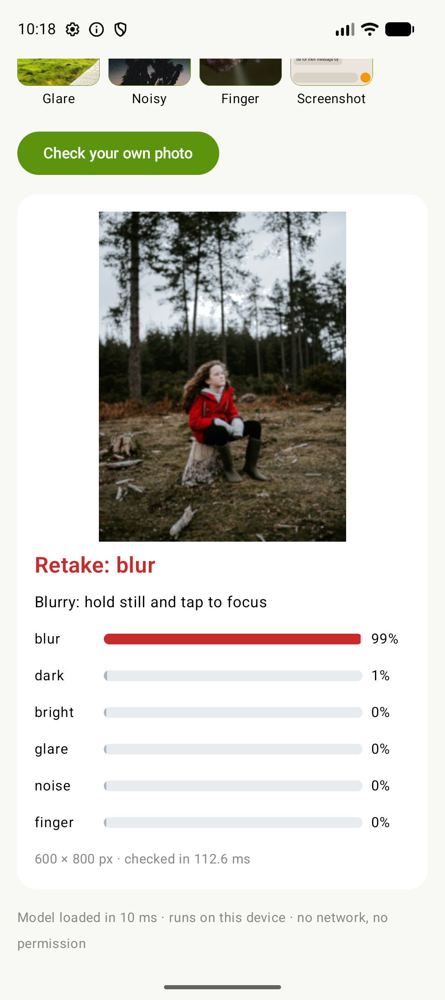
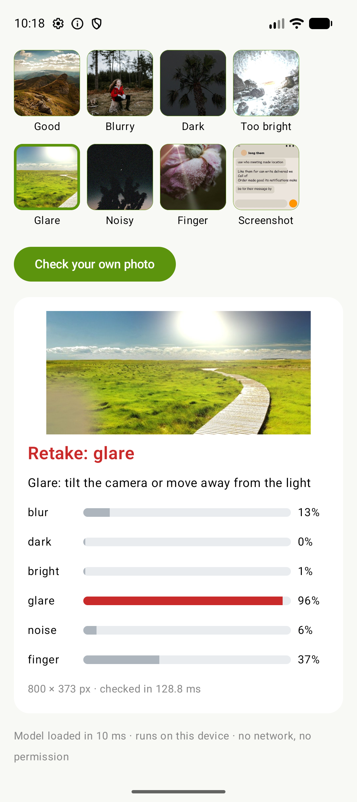
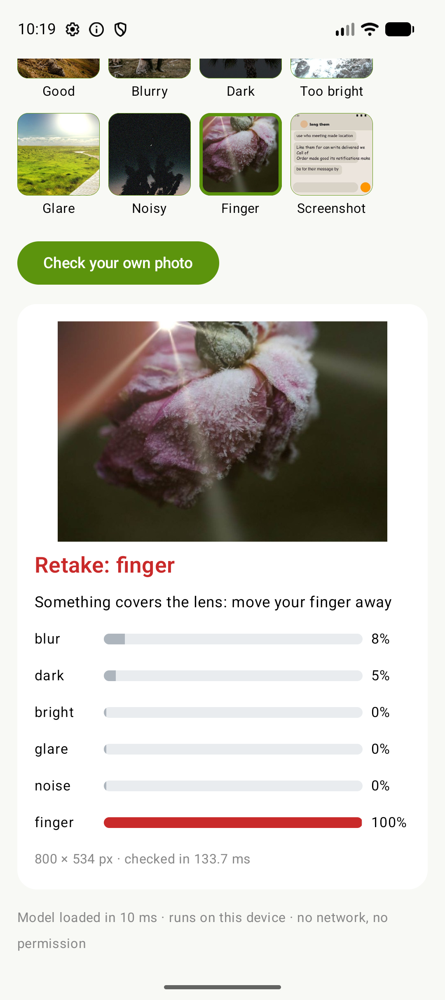
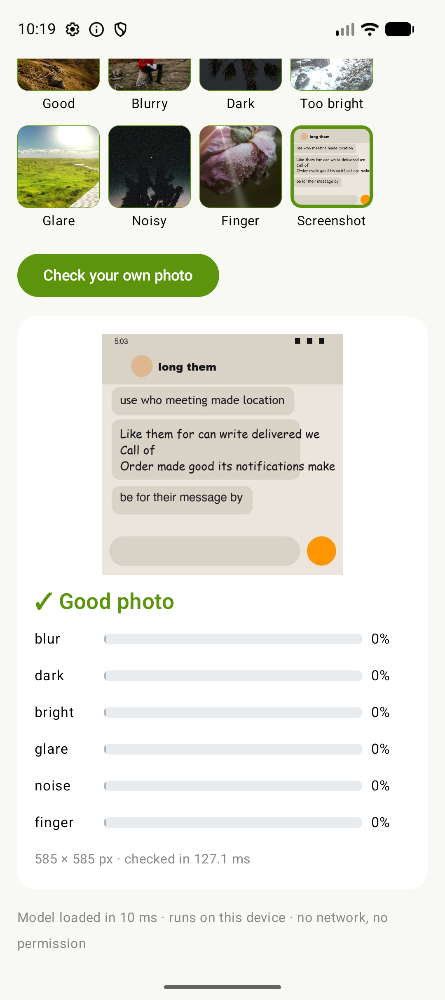
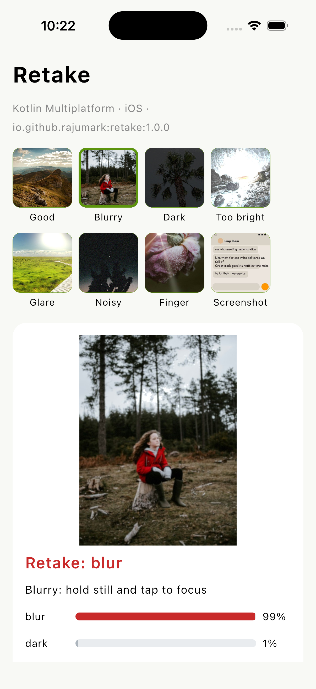
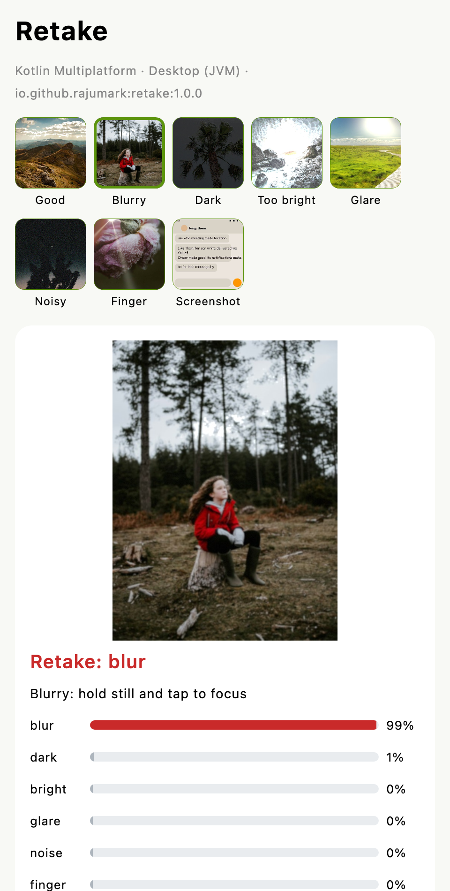
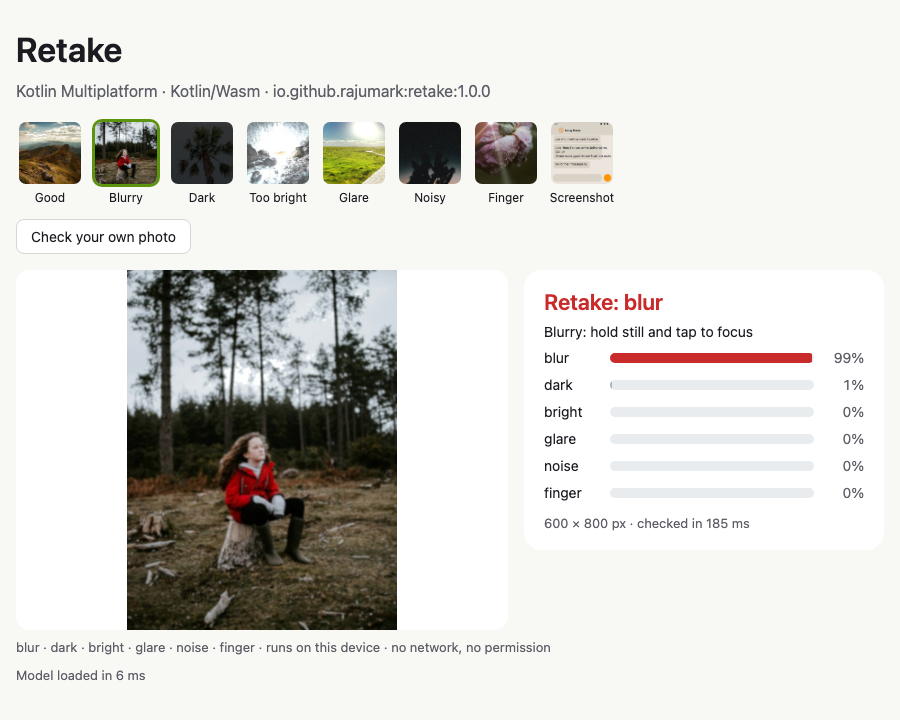

# Retake 📸

**[Website](https://rajumark.github.io/retake/)** · **[All Hoverfly models](https://rajumark.github.io/hoverfly/#models)** · [Maven Central](https://central.sonatype.com/artifact/io.github.rajumark/retake)

By [Hoverfly](https://rajumark.github.io/hoverfly/). On-device photo quality checker for **Kotlin Multiplatform**: Android, iOS, macOS, JVM desktop, JavaScript and WebAssembly. It looks at a photo and says whether it's good or should be retaken, and why: **blurry, too dark, too bright, glare, noisy, or a finger over the lens**.

```kotlin
import io.github.rajumark.hoverfly.retake.Retake

Retake().use { retake ->
    val check = retake.check(pixels, width, height)   // ARGB pixels: a Bitmap, a camera frame, an ImageBitmap
    if (!check.isGood) showHint(check.issues.first().hint)
    // a shaky photo: PhotoCheck(retake: BLUR, blur=0.991, dark=0.012, bright=0.002, glare=0.0, noise=0.0, finger=0.0)
}
```

- **Six problems, one call.** A score from 0 to 1 for blur, dark, bright, glare, noise and finger, plus the verdict and a short hint for each problem.
- **Screenshots are not photos.** Screenshots, documents, chats and graphics count as good, so a gallery app doesn't flag them.
- **Tiny.** 0.5 MB of int8 weights, 0.48M parameters.
- **No dependencies.** Inference is plain Kotlin. There is no ONNX Runtime, TFLite, ML Kit or native code.
- **Private and offline.** The model ships inside the library on every platform. There is no network, no permission and no telemetry.
- **Every platform, same results.** Android, iOS, macOS, JVM desktop, JavaScript and WebAssembly, tested against the reference model on each.

## Install

```kotlin
// build.gradle.kts: commonMain, or any platform source set
dependencies {
    implementation("io.github.rajumark:retake:1.0.0")
}
```

It's on Maven Central, so no extra repository is needed. Gradle picks the right artifact for each platform:

| Platform | Artifact |
|---|---|
| Android (minSdk 21) | `retake-android` |
| JVM desktop (Java 8+) | `retake-jvm` |
| iOS device and simulator (arm64) | `retake-iosarm64`, `retake-iossimulatorarm64` |
| macOS (arm64) | `retake-macosarm64` |
| JavaScript (browser, Node) | `retake-js` |
| WebAssembly (browser, Node) | `retake-wasm-js` |

## Screenshots

The sample app with the example photos. Every check runs on the device.

| Blurry | Glare | Finger | Screenshot |
|---|---|---|---|
|  |  |  |  |
| retake: blur 99% | retake: glare | retake: finger 100% | good (not a camera photo) |

The KMP sample on each platform:

| Android | iOS | Desktop | Web (Wasm) |
|---|---|---|---|
|  |  |  |  |

## Use

```kotlin
val retake = Retake()          // loads the model: do it off the main thread, keep one instance

val check = retake.check(argb, width, height)        // ARGB ints (0xAARRGGBB), row by row
val check2 = retake.checkRgb(rgb, width, height)     // or RGB bytes, 3 per pixel

check.isGood                   // true when no issue reached the line
check.issues                   // the problems found, most certain first: [BLUR, DARK]
check.score(Issue.GLARE)       // 0..1
check.scores                   // every issue's score
check.strongest                // (issue, score) with the highest score, even when below the line
Issue.BLUR.hint                // "Blurry: hold still and tap to focus"

retake.check(argb, width, height, threshold = 0.7f)  // stricter line: only clear problems (default 0.5)
retake.close()                 // frees the model's memory
```

Any size works: photos larger than 1024 px on the long side are shrunk first (area averaging, like the model was
trained), smaller ones are used as they are. `check()` is thread-safe.

On Android there are two shortcuts:

```kotlin
retake.check(bitmap)                 // an upright Bitmap (camera preview, decoded photo)
retake.check(context, uri)           // a photo file or content:// Uri: decoded at reduced size + EXIF-rotated (blocking)
```

`check(context, uri)` decodes large camera photos at 1/2, 1/4 or 1/8 size, which makes it several times faster than
decoding the full photo first.

From Java:

```java
try (Retake retake = new Retake()) {
    PhotoCheck check = retake.check(argb, width, height);
}
```

### API

| | |
|---|---|
| `Retake()` | Loads the bundled model. `AutoCloseable`. |
| `check(argb, width, height, threshold = 0.5)` | Checks ARGB pixels. Returns a `PhotoCheck`. |
| `checkRgb(rgb, width, height, threshold = 0.5)` | Checks RGB bytes. |
| `PhotoCheck.isGood` / `issues` / `scores` / `score(issue)` / `strongest` | The verdict, the problems found (most certain first), every score (0..1). |
| `Issue` | `BLUR`, `DARK`, `BRIGHT`, `GLARE`, `NOISE`, `FINGER`, each with a short `hint`. |
| `Retake.check(bitmap)`, `Retake.check(context, uri)` | Android only. |

## Quality

**Real photos.** On 240 random photos from the LIVE In the Wild Challenge database (real phone photos with real
defects), hand-labelled before the model was tested on them and scored once: Retake's verdict is right for **86.6%**
of them. It keeps 87.9% of the good photos and catches 73.7% of the bad ones.

| | Retake | OpenCV rules (Laplacian + histogram) | CLIP ViT-B/32 zero-shot |
|---|---|---|---|
| Real photos: verdict right | **86.6%** | 52.7% | 19.4% |
| Real app screenshots wrongly flagged (102) | **0** | — | — |
| Generated defects (7,428 test photos): verdict right / issue F1 | **92.0% / 0.888** | 72.2% / 0.51 | 75.3% / 0.40 |
| Real blur ranking (BID, 586 photos): blurry-vs-sharp AUC | **0.862** | 0.837 | 0.789 |
| Size | **0.5 MB** | — | ~350 MB |

The OpenCV rules and CLIP had their lines tuned on the validation set, to be fair to them. The OpenCV rules can't
detect a finger at all, and with tuned lines they still flag about half of all good photos; CLIP flags almost every
photo for something.

**Speed.** One check of a 1040 × 780 photo (shrink, views and model) in the pure-Kotlin library takes about 90 ms on a
laptop JVM and about 235 ms in a browser (JS or Wasm). In the release sample app on an Android emulator, an 800 px photo
takes 110–150 ms. It's made for checking a photo after it's taken, not every preview frame.

**Where it falls short:** real glare (sun through a windshield, reflections on glossy paper) is caught less often than
the other problems. Very dark night photos taken on purpose, or deliberate motion blur, can be flagged; raise the
`threshold` if your app should be lenient. Finger detection was tested mostly on generated fingers, because almost no
public photos show one.

## Sample apps

`sample/` is a separate Gradle build that uses the **published** library, never the source. It resolves `io.github.rajumark` only from Maven Local, or from Maven Central with `-PretakeRepo=central`. It has a Compose Multiplatform app for Android, desktop and iOS (8 example photos; on Android and desktop you can also check your own photo), and a web page built for both Kotlin/JS and Kotlin/Wasm.

```bash
./gradlew :retake:publishToMavenLocal
cd sample
./gradlew :androidApp:installRelease
./gradlew :desktopApp:run
./gradlew :webApp:wasmJsBrowserDevelopmentRun     # or :webApp:jsBrowserDevelopmentRun
open iosApp/iosApp.xcodeproj                       # run the iosApp scheme on a simulator
```

The example photos are from [Unsplash](https://unsplash.com) (Unsplash License) with generated defects, plus one
generated screenshot. Each one shows a different issue.

## Project layout

```
retake/                        the library
  src/commonMain/              public API (Retake, PhotoCheck, Issue) and the model in plain Kotlin
                               (internal/: Photo (resize + views), Network)
  src/androidMain/             Bitmap and Uri shortcuts
  src/{jvm,android,embedded}Main/   model loading
  src/modelData/               retake.bin (int8 weights)
  src/commonTest/              parity with the reference on 13 images, API, latency; runs on every target
demo/                          the library compiled to Wasm for the website's live demo
sample/                        demo apps using the published artifacts
docs/                          website (rajumark.github.io/retake)
```

On JVM and Android the model ships as Java resources in the jar/AAR. Kotlin/Native and the web have no resources, so the build compiles it into the library (`generateEmbeddedModel`).

## Tests

```bash
./gradlew :retake:jvmTest
./gradlew :retake:testAndroidHostTest
./gradlew :retake:connectedAndroidDeviceTest              # on a connected device/emulator
./gradlew :retake:iosSimulatorArm64Test
./gradlew :retake:macosArm64Test
./gradlew :retake:jsNodeTest :retake:jsBrowserTest
./gradlew :retake:wasmJsNodeTest :retake:wasmJsBrowserTest
```

The parity tests start from raw RGB images (incl. one that has to be shrunk to 1024 px and one under 128 px). On every
target they require the same 4 detail crops as the reference implementation (OpenCV + PyTorch) and every score within
0.002 of it; the largest difference on any target is 0.00023.

## How it works

Blur and noise disappear when a photo is shrunk, but exposure, glare and a finger need the whole picture, so the model
looks at two views. The whole photo is squeezed to 224 × 224. Four crops of 128 × 128 come from the photo at 1024 px:
the three most textured parts (where blur shows) and the flattest mid-grey part (where noise shows). Two small
MobileNet-style CNNs read the views, and a small head gives a score per problem. The weights are int8 with one scale
per output channel; batch-norm is folded into the convolutions.

It was trained from scratch, without ImageNet weights, on about 58,000 clean photos from Open Images and Unsplash (69,000 downloaded; the ones that were already blurry, dark or blown out were left out).
Each photo was damaged in code: out of focus, motion and hand shake, under and over exposure, glare, flare and
reflections, sensor noise, a finger at the edge of the lens. Each defect was generated at strengths on both sides of
the line where a person would retake the photo. Generated screenshots, chats, documents and posters taught it that
graphics are not bad photos.

## Publishing

See [PUBLISHING.md](PUBLISHING.md).

## More Hoverfly models

Retake is one of nine small on-device models by [Hoverfly](https://rajumark.github.io/hoverfly/), all with the same install, the same free tier and nothing sent to a server.

| Model | What it does | Source |
|---|---|---|
| 🙂 [Moji](https://rajumark.github.io/moji/) | Emoji suggestions in 22+ languages | [GitHub](https://github.com/rajumark/moji) |
| 🗼 [Beacon](https://rajumark.github.io/beacon/) | Language and script detection, Hinglish included | [GitHub](https://github.com/rajumark/beacon) |
| ✍️ [Comma](https://rajumark.github.io/comma/) | Punctuation and capitals for voice-typed text | [GitHub](https://github.com/rajumark/comma) |
| 💬 [Comeback](https://rajumark.github.io/comeback/) | Smart replies to tap | [GitHub](https://github.com/rajumark/comeback) |
| 😊 [Emotion](https://rajumark.github.io/emotion/) | 28 emotions and an overall mood per message | [GitHub](https://github.com/rajumark/emotion) |
| 🛡️ [Gatekeeper](https://rajumark.github.io/gatekeeper/) | Toxic message detection for Indian chat | [GitHub](https://github.com/rajumark/gatekeeper) |
| 🏚️ [Hideout](https://rajumark.github.io/hideout/) | Finds and hides phone numbers, UPI, Aadhaar and more | [GitHub](https://github.com/rajumark/hideout) |
| 🖍️ [Chalk](https://rajumark.github.io/chalk/) | Doodle recognition, even before the drawing is finished | [GitHub](https://github.com/rajumark/chalk) |

See them all on the [Hoverfly website](https://rajumark.github.io/hoverfly/#models).

## Pricing & license

**Free for up to 10,000 monthly active devices.** You don't need an API key, an account or a license file: add the dependency and ship. It works in commercial apps too, with no limit on how often each device runs it.

| | Community | Commercial | Custom models |
|---|---|---|---|
| **Price** | Free | Contact us | Contact us |
| **For** | Products with up to 10,000 monthly active devices per platform | Products above 10,000 monthly active devices on any platform | A model trained for your own language, domain or task |
| **Includes** | Commercial use, unlimited calls, no key or sign-up | One license per product per model, direct support, early access to updates | Designed and trained by Hoverfly, shipped as a plain Kotlin library |

**How devices are counted.** A monthly active device is a device that runs Retake at least once in a calendar month. The limit applies separately to each product, each platform (Android, iOS, web…) and each Hoverfly model. Once a product passes it, you have 30 days to get a commercial license. The library keeps working and never checks in with a server.

**Not allowed** under any tier (unless agreed in writing):

- selling or redistributing Retake or its model on its own, or inside another SDK or library
- extracting, modifying, fine-tuning or retraining the model weights
- using the model or its outputs to train or distill another model
- reverse engineering the model or its file format
- offering it as a hosted API for others

**Custom models.** Hoverfly also designs and trains small, fast on-device models for your needs: image quality, document and ID checks, moderation, classification, language detection and more.

**Contact** for a commercial license or a custom model: [raju348636@gmail.com](mailto:raju348636@gmail.com) or **+91 63533 21951** (call or WhatsApp).

Full terms: [Hoverfly Community License](LICENSE).

The model was trained on photos from [Open Images](https://storage.googleapis.com/openimages/web/index.html) (CC BY 2.0) and the [Unsplash Lite dataset](https://unsplash.com/data) (Unsplash License).
